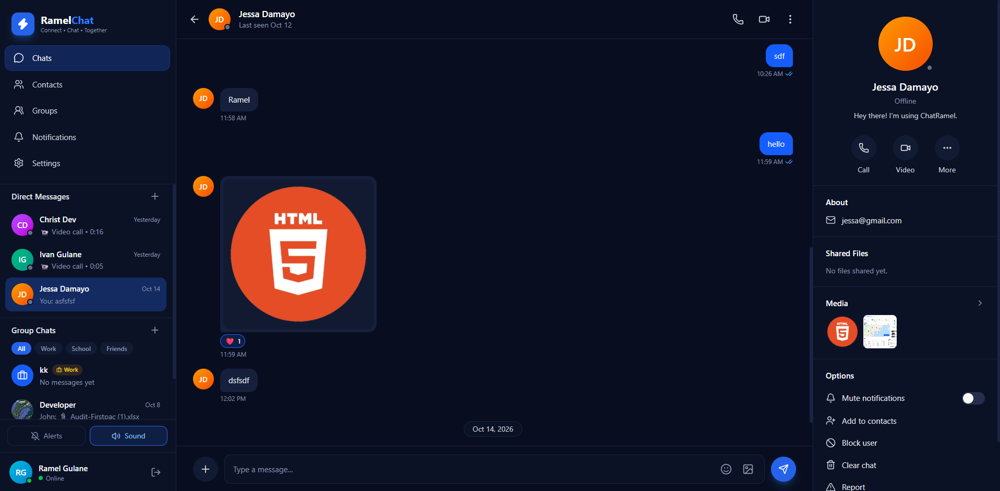
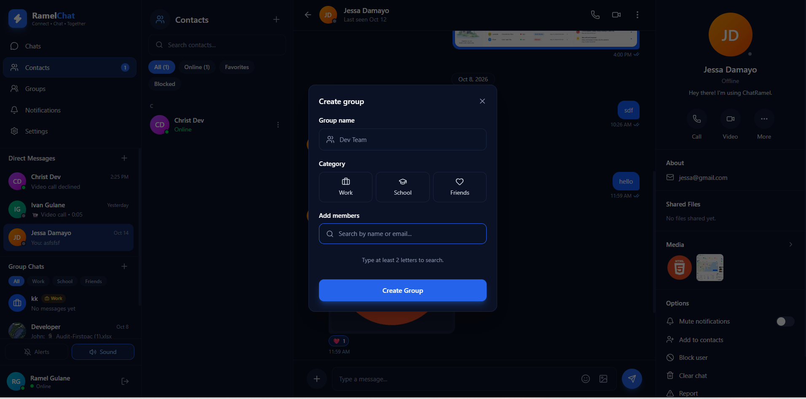
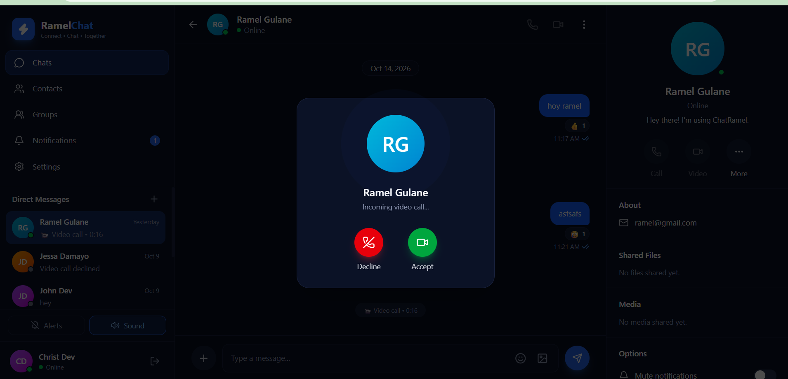

# ChatRamel

A real-time chat app built with the MERN stack. Users can message each other directly, create group chats, share images and files, react to messages, and make voice and video calls. It is fully responsive from phone to desktop.

> **Live demo:** _add your link here_

## Screenshots

_Add your screenshots here, for example:_

```md



```

## Features

**Messaging**
- Real-time direct messages with Socket.io
- Typing indicators and online/offline presence with "last seen"
- Read receipts and unread badges
- Send images and files (PDF, Word, Excel, PowerPoint, TXT, CSV, ZIP)
- Emoji picker and message reactions
- Search for any user by name, email, or username to start a chat

**Groups**
- Create groups with a name and a category (Work, School, Friends)
- Admins can add or remove members, edit group info and photo, and promote or demote admins
- Anyone can leave a group
- Filter and search groups

**Calls**
- One-to-one voice and video calls using WebRTC
- Incoming call screen with accept and decline
- Mute, camera toggle, and hang up
- Calls only connect when the other user is online

**Contacts, notifications, and safety**
- Save contacts, mark favorites, and see who is online
- Block and unblock users, clear a chat, and report users
- Notifications for missed calls and group updates
- Browser alerts and a message sound

**Account**
- Sign up and log in with JWT stored in an httpOnly cookie
- Edit profile photo, name, username, email, and bio
- Change password (other devices are signed out) and delete account

## Tech Stack

| Area | Technologies |
|---|---|
| Frontend | React, Vite, Tailwind CSS, React Router, Lucide icons, react-hot-toast, emoji-picker-react |
| Backend | Node.js, Express |
| Database | MongoDB Atlas, Mongoose |
| Real-time | Socket.io, WebRTC |
| Auth and security | JWT (httpOnly cookie), bcrypt, express-rate-limit, multer |

## Project Structure

```
ChatRamel/
├── backend/
│   ├── config/          # database connection
│   ├── controllers/     # route logic
│   ├── middleware/      # auth, uploads, rate limits, errors
│   ├── models/          # Mongoose models
│   ├── routes/          # API routes
│   ├── socket/          # Socket.io handlers (messages, typing, calls, presence)
│   ├── utils/           # helpers
│   └── server.js
└── frontend/
    └── src/
        ├── components/  # chat, sidebar, groups, contacts, settings, call...
        ├── context/     # auth, chat, socket, presence, contacts, notifications, call
        ├── hooks/
        ├── layouts/
        ├── pages/
        └── utils/
```

## Getting Started

### Prerequisites
- Node.js 18 or newer
- A MongoDB Atlas cluster (the free tier works)

### 1. Clone the repository

```bash
git clone https://github.com/Ramelzkie99/ChatRamel.git
cd ChatRamel
```

### 2. Set up the backend

```bash
cd backend
npm install
```

Create a `backend/.env` file:

```env
PORT=5000
MONGO_URI=mongodb+srv://<user>:<password>@cluster0.xxxxx.mongodb.net/chatramel?retryWrites=true&w=majority
JWT_SECRET=your_long_random_secret
CLIENT_URL=http://localhost:5173
NODE_ENV=development

# Optional: only needed for calls across strict networks
# TURN_URLS=turn:your-turn-host:3478
# TURN_USERNAME=
# TURN_CREDENTIAL=
```

Generate a secret with:

```bash
node -e "console.log(require('crypto').randomBytes(48).toString('hex'))"
```

Start the server:

```bash
npm run dev
```

### 3. Set up the frontend

```bash
cd frontend
npm install
npm run dev
```

Open [http://localhost:5173](http://localhost:5173), create two accounts (one in a normal window and one in an incognito window), and start chatting.

Optional `frontend/.env`:

```env
VITE_API_URL=http://localhost:5000/api
VITE_SOCKET_URL=http://localhost:5000
```

## Testing Calls Locally

Browsers allow camera and microphone access on `localhost`. When testing with two windows on one computer, both windows may share one webcam. If the second window reports the camera is in use, test voice calls, or start one browser with Chrome's `--use-fake-device-for-media-stream` flag.

## Notes

- Calls use Google's public STUN servers by default. Some strict networks (certain mobile data and office networks) need a TURN server. Add the optional `TURN_*` values to `backend/.env` to enable one.
- Uploaded images and files are stored on the server's disk. For deployment on hosts with temporary storage (such as Render or Railway), move uploads to a service like Cloudinary or S3.
- Camera and microphone require HTTPS once deployed.

## Roadmap

- Message search
- Per-chat mute
- Email verification and password reset
- Group video calls
- Screen sharing

## Author

**Ramel Gulane**
GitHub: [@Ramelzkie99](https://github.com/Ramelzkie99)

## License

This project is open source and available under the [MIT License](LICENSE).
